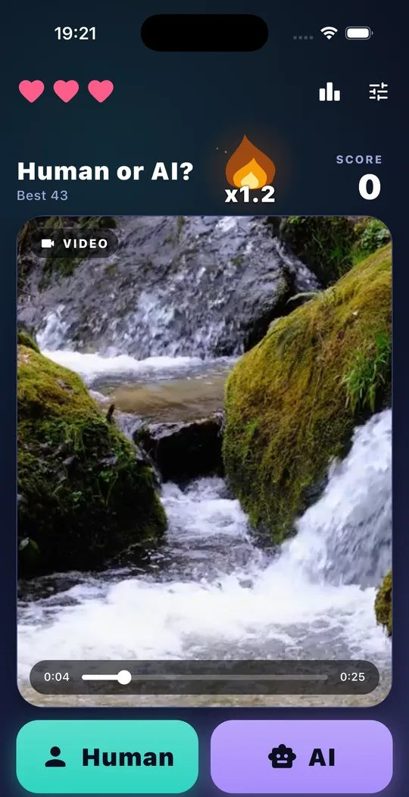
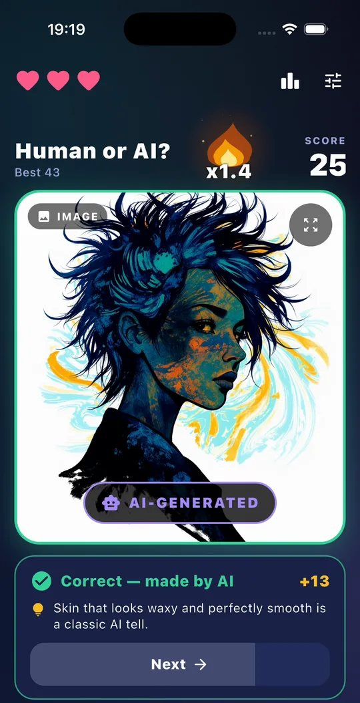
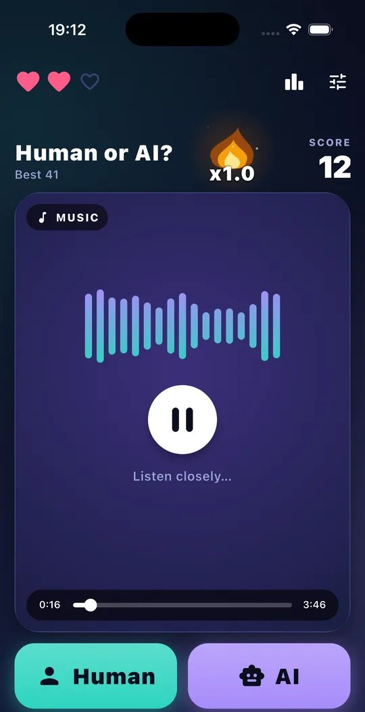
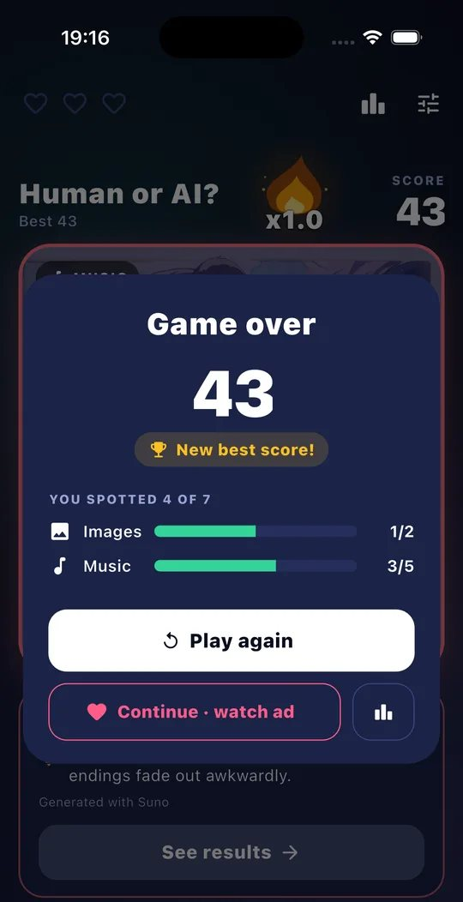
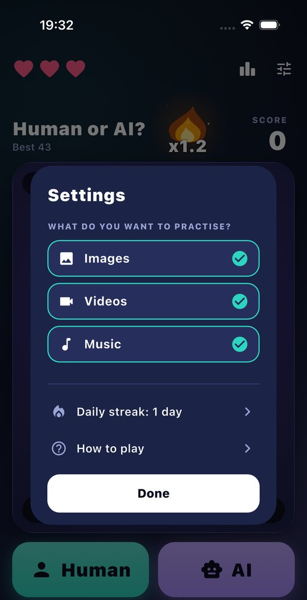
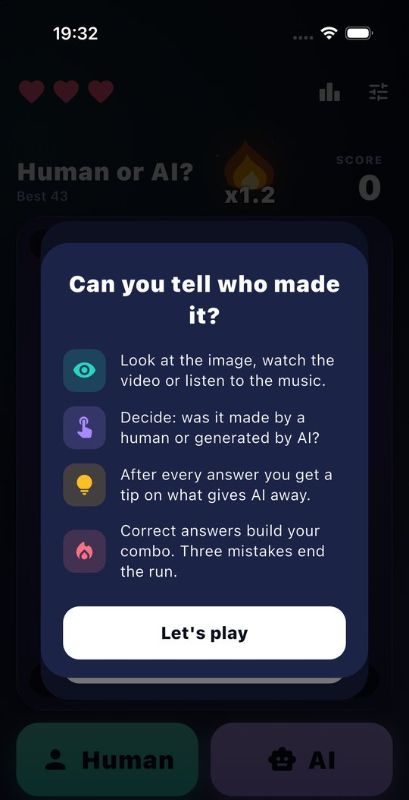

# Human or AI?

A mobile game (Flutter) that trains people to tell AI-generated images, videos and music from work made
by humans. Each round shows one item; the player answers **Human** or **AI**, sees the truth and gets a
short tip on what gives AI away.

- Android: <https://play.google.com/store/apps/details?id=inu.night.humanAI>
- Website: <https://web-ai-vs-humna.vercel.app> (repo: `JakubJakubiak/web-ai-vs-humna`)
- Content lists: `JakubJakubiak/jsonList`

## Screenshots

| Video round | Answer and tip | Music round |
|---|---|---|
|  |  |  |

| Game over | Settings | How to play |
|---|---|---|
|  |  |  |

## How the game works

1. The app downloads the content lists and deals a shuffled deck.
2. A round shows one image, video or song. Images can be opened full screen and zoomed; videos and
   music start by themselves.
3. The player taps **Human** or **AI**.
4. The card shows a verdict stamp (`AI-GENERATED` / `HUMAN-MADE`), the panel below says whether the
   answer was right and gives a tip. For music the title, cover and credit appear only now, so they
   cannot give the answer away.
5. The next round starts by itself (1.8 s after a correct answer, 2.8 s after a miss); **Next** skips the wait.
6. After the third miss the game over dialog shows the score, the best score and accuracy per media type.

### Scoring

| Rule | Value |
|---|---|
| Lives | 3 (`GameScreen.initialHealth`) |
| Points for a correct answer | `10 × combo`, rounded down; doubled with Premium |
| Combo after a correct answer | `combo × 1.1`, one decimal, at most 12 |
| Combo after a miss | back to 1.0 |
| Starting combo | 1.0 without a streak, otherwise `1.2 + 0.5 × (streak days ÷ 2)`, at most 10 |

The combo flame grows and changes colour with the multiplier: ember at x1.0, orange fire while it
builds, violet plasma from about x5.

### Other screens

- **Settings** (top right): choose which content to practise (at least one type stays on), open the
  daily streak and the how-to-play intro. The choice is remembered.
- **How to play**: shown once on first launch.
- **Leaderboard**: Google Play Games / Game Center (`games_services`).
- **Game over**: *Play again* starts a new run; *Continue · watch ad* shows a rewarded ad and restores
  all lives while keeping the score. A revive from the shop (or Premium's free one) does the same without
  the ad.
- **Shop** (store icon, top right): see below.

## Shop

In-app purchases go straight to Google Play Billing and StoreKit through the official
`in_app_purchase` plugin; there is no RevenueCat and no server. What the player owns is kept on the
device (`Wallet`, `shared_preferences`) and checked against the store at every start.

| Product id | Type | What it does | Price (set in Play Console) |
|---|---|---|---|
| `premium` | subscription, base plan `monthly` | 2× points, no banner ads, one free revive per run | $2.99 / month |
| `no_ads` | one-time (Apple: non-consumable) | removes the banner ad for good | $2.99 |
| `revives_5` | consumable | 5 revives | $0.99 |
| `revives_20` | consumable | 20 revives | $2.99 |

The ids must be created exactly like this in Play Console (*Monetize → Products*: one-time products and
a subscription `premium` with an auto-renewing monthly base plan) and in App Store Connect. Play
Console only lets you add products after a build with the billing permission (3.1.0+) has been uploaded.
Until the products exist the shop shows "—" instead of prices and nothing can be bought.

- At start the app asks the store for the current purchases (`restorePurchases`; with StoreKit 2 this
  needs no password). That keeps Premium in sync with renewals and cancellations, brings *Remove ads* back
  after a reinstall and pays out revive packs whose purchase was interrupted. Offline, the last known
  state is kept.
- Each purchase id is paid out once (`Wallet.credit`), so a restored purchase never adds revives twice.
- Revives are not restorable: they live on the device.
- Premium points go to the leaderboard like any other score.
- The shop links to the terms of use (Apple's standard EULA) and the privacy policy, and to the store's
  subscription page while Premium is active, as Apple requires for subscriptions.

## Store graphics

`store/make_store_graphics.py` builds the store screenshots and the Google Play feature graphic from
full-resolution emulator screenshots in `store/source/`:

```bash
python3 store/make_store_graphics.py
```

| Output | Size | Use |
|---|---|---|
| `store/google-play/phone/*.png` | 1080 × 1920 | Google Play phone screenshots |
| `store/google-play/feature-graphic.png` | 1024 × 500 | Google Play feature graphic |
| `store/app-store/iphone-6.9/*.png` | 1320 × 2868 | App Store, 6.9" iPhone |
| `store/app-store/iphone-6.5/*.png` | 1242 × 2688 | App Store, 6.5" iPhone |

Headlines and the UI element that is blown up out of the phone are set in `SHOTS` at the top of the
script. To take new source screenshots: run a debug build on the Android emulator, turn on the status bar
demo mode (`adb shell am broadcast -a com.android.systemui.demo -e command clock -e hhmm 0941`, etc.),
hide the banner by setting `flutter.shopNoAds` in the app's preferences (`adb shell run-as
inu.night.humanAI`), and save with `adb exec-out screencap -p`.

## Content

The app has no backend. It downloads five JSON lists from the `jsonList` repository
(`lib/api/content_repository.dart`):

| File | Content |
|---|---|
| `humnOrAi.json` | images, `{link, op: "ai" \| "human", credit?}` |
| `video_links_ai.json`, `video_links_human.json` | videos, `{url, op}` |
| `tinyncsmusic.json` | human music, `{url, track, artistraw, cover}` |
| `SunoMusicList.json` | AI music, `playlists[].playlist_clips[].clip.audio_url` |

Each list loads on its own, so one broken file only removes that kind of content. For every media type
the deck holds the same number of AI and human items, so the type never gives the answer away. Media that
fails to load is skipped without costing a life. Dead links are cleaned up, and new items proposed, by the
GitHub Actions in `jsonList`.

## Project layout

```
lib/
  main.dart                          app start, Firebase, ads
  api/content_repository.dart        loading and parsing the lists, deck building
  models/game_item.dart              one round: url, type, AI or human
  features/shop/
    shop_items.dart                  products and their ids
    store_service.dart               Google Play Billing / StoreKit
    wallet.dart                      what the player owns (Premium, no ads, revives)
    shop_sheet.dart                  the shop screen
  features/game_screen/
    game_screen.dart                 game state and layout
    tips.dart                        tips shown after each answer
    streak_service.dart              daily streak
    widgets/                         media card, answer bar, effects (combo flame, sparks),
                                     settings, how to play, game over, streak sheet
  utils/app_colors.dart              colours (shared with the website)
test/content_repository_test.dart    parsing and deck tests
test/wallet_test.dart                shop: paying out purchases, revives, Premium
store/                               store screenshots and the script that makes them
```

## Configuration

| What | Where |
|---|---|
| Ads on/off, leaderboard IDs | `lib/utils/constants.dart` |
| Ad unit IDs (debug builds use Google test units) | `lib/modules/admob_service.dart` |
| Address of the content lists | `ContentRepository._base` in `lib/api/content_repository.dart` |
| Timings (auto-advance, media timeout, skipped dead links in a row) | constants at the top of `_GameScreenState` |
| Tips shown after answers | `lib/features/game_screen/tips.dart` |
| Colours | `lib/utils/app_colors.dart` |
| App icon | `lib/logoIcon/icon.webp` (Android), `lib/logoIcon/ios_icon.jpg` (iOS) |

Saved on the device (`shared_preferences`): best score, enabled content types, whether the intro was
shown, and the dates used for the daily streak.

## Adding content

Content is not part of the app. Add or remove entries in the `jsonList` repository and every installed
copy of the game picks them up on the next start. That repository also has a bot that proposes new
items and removes dead links; see its README.

## Running

```bash
flutter pub get
flutter test
flutter run
```

iOS notes (Flutter 3.44 / Xcode 27):

- Minimum iOS is 15.
- Swift Package Manager is turned off in `pubspec.yaml` because the Firebase and AdMob plugin versions
  used here only support CocoaPods.
- If `pod install` fails with an encoding error, run it with `LANG=en_US.UTF-8`.
- `flutter build ios --simulator` may fail on an architecture check; `flutter run -d <simulator>` works.

## Releasing

```bash
flutter test
flutter build appbundle --release      # Android, upload to Google Play
flutter build ipa --release            # iOS, upload with Xcode or Transporter
```

Raise `version` in `pubspec.yaml` before each release; the number after `+` is the build number and
must be higher than the one already in the store.

Android signing: put the upload keystore somewhere outside the repository and create
`android/key.properties` (ignored by git):

```properties
storeFile=/absolute/path/to/upload-keystore.jks
storePassword=...
keyAlias=...
keyPassword=...
```

Without that file release builds are signed with the debug key, which is enough to compile and test
locally but is rejected by Google Play. If the upload key is lost, request a reset in Play Console
(App integrity → Upload key).

Android build notes (Flutter 3.44): Android Gradle Plugin 8.9.1, Kotlin 2.1.0, Gradle heap 4 GB.
`minSdkVersion` is 33, so the game installs only on Android 13 and newer.

Test on a real Android device before publishing: the redesign was verified on the iOS simulator, and
on Android only the debug and release builds were compiled.

## Fishing game (`fishing-game/`)

A separate fishing game, not part of the Human or AI app. Full description: [`fishing-game/README.md`](fishing-game/README.md).

- `fishing-game/index.html`: a 2D version (canvas, plain JS).
- `fishing-game/3d/`: Sakura River 3D (three.js, bundled locally) with water reflections, shader grass and Blender models
  from `JakubJakubiak/sakura-river` (trees, bridge, pagoda, lanterns, Fuji). Run `python3 -m http.server` in `fishing-game`
  and open `http://localhost:8000/3d/`.
- How to play: hold to charge the cast and release to cast. When the bobber dives, tap. While reeling, hold to reel in
  and let go when the tension bar turns red. Species: roach, perch, carp, trout, koi, pike.
- Android: `fishing-game/android/` (Capacitor). `npm install && npx cap sync android && npx cap open android`.
- Chat version for streams: the `view=fishing` view in the sakura-river repo (`!wedka`, `!zatnij`).

## Known gaps

- Ad consent is granted in code (`main.dart`); players in the EU need a consent dialog.
- The privacy policy on the website does not yet mention AdMob, Firebase Analytics and in-app purchases.
- The iOS build allows iPad, so App Store Connect also asks for iPad screenshots (none are made yet).
- `lib/features/game_screen/widgets/FlameBoostAnimation .dart` (the old pixel flame) is no longer used.
