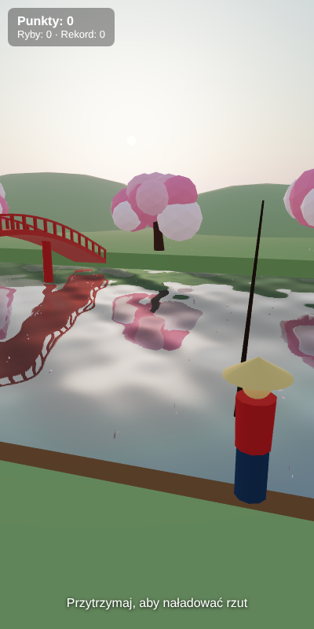

# Sakura River

Prosta gra wędkarska w jednym pliku (`index.html`, czysty JS + canvas, bez bibliotek).
Widok jak w akwarium: przekrój rzeki, czerwony japoński most, kwitnące wiśnie, spadające płatki, rybak z wędką na brzegu.

## Sterowanie
1. Przytrzymaj palec (albo spację), żeby naładować siłę rzutu, i puść, żeby zarzucić.
2. Ryby podpływają do haczyka. Kiedy spławik zanurkuje (napis „BRANIE!”), szybko dotknij.
3. Hol: trzymaj, żeby zwijać. Puść, kiedy pasek napięcia robi się czerwony, bo inaczej linka pęknie.
   Jeśli puszczasz za długo, ryba się zerwie.

Gatunki: płotka, okoń, karp, pstrąg, szczupak, koi. Im rzadsza ryba, tym więcej punktów i tym mocniej walczy.
Rekord zapisuje się w localStorage.

## Android
- Najszybciej: zapakować folder w Capacitor (`npx cap init`, `npx cap add android`, `webDir` = ten folder)
  albo wyświetlić `index.html` w WebView.
- Godot 4: nie da się uruchomić tego kodu JS w Godocie, ale logika (stany `idle/charging/flying/waiting/bite/reeling`)
  przenosi się 1:1 do GDScript. Model 3D z Blendera (.glb) można podpiąć jako rybaka/most.

## Wersja 3D (`3d/`)
three.js z prawdziwymi odbiciami w wodzie (`Water`, `Sky`). Ten sam system łowienia,
płatki sakury spadają i płyną z prądem, ryby to cienie pod powierzchnią, a złowiona ryba wyskakuje na żyłce.
Wszystko jest lokalnie w `3d/lib/` (three.js 0.160, licencja MIT), więc działa offline i w APK.
Pliki trzeba otwierać przez serwer (moduły ES), np. `python3 -m http.server` w folderze `fishing-game`
i potem `http://localhost:8000/3d/`.



## APK na Androida (Capacitor)
Projekt Android jest gotowy w `fishing-game/android/` (Capacitor 6, gra z `3d/`, tylko pionowo).

```bash
cd fishing-game
npm install
npx cap sync android     # kopiuje 3d/ do aplikacji (zrób to po każdej zmianie gry)
npx cap open android     # otwiera Android Studio → Run ▶ albo Build → Build APK(s)
```
Bez Android Studio, gdy masz zainstalowany Android SDK: `cd android && ./gradlew assembleDebug`.
Gotowe APK będzie w `android/app/build/outputs/apk/debug/app-debug.apk`.
